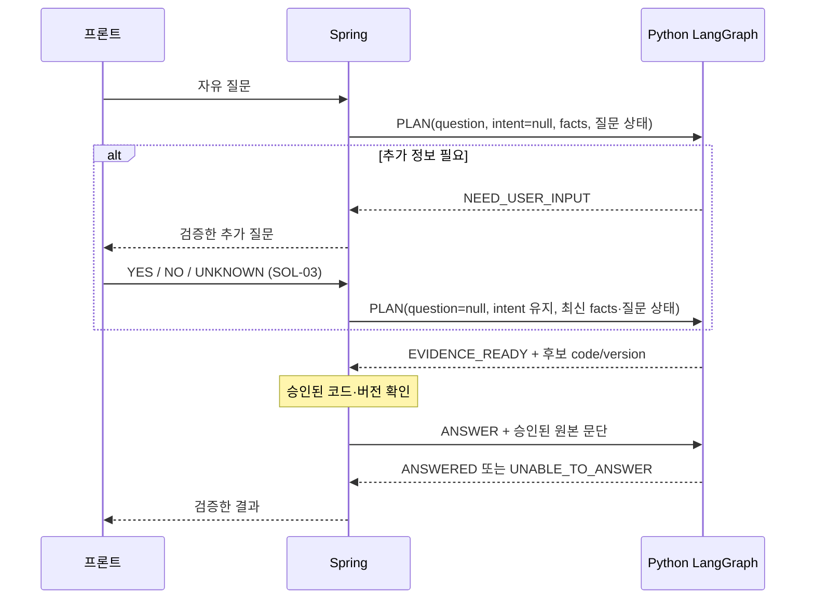

# 상담 assist 내부 API 계약 초안 v1

기준: 2026-11-17 Spring 담당자가 공유한
`docs/solution-langgraph-integration-plan.md` 3.1장 계약과 추가 검증 규칙.
이 저장소에는 Spring 원본 계획서가 없으므로 공유받은 내용을 아래에 기록한다.
필드명·상태·URL은 공유 계약을 유지했다. 확정 전 합의 항목은 마지막 절에 구분한다.

## 1. 경로와 공통 규칙

`POST /internal/ai/solutions/assist`. PLAN·ANSWER는 같은 URL을 사용하고 본문 `phase`로 구분한다.

| 항목 | 규칙 |
| --- | --- |
| 요청 헤더 | `Content-Type: application/json`, `X-Internal-Api-Key`, `X-Request-Id: <UUID>` |
| 요청 ID | 헤더로만 전달. 본문의 `requestId`로 대체할 수 없으며 로그 추적에만 사용 |
| 성공 | HTTP 200, `{"success":true,"data":{...}}`. success는 실제 boolean |
| 실패 | 비-2xx. Spring은 본문과 관계없이 실패 처리하며 사용자에게 503, 상담 상태 유지. Spring 자동 재시도 없음 |
| 상태 | Python은 요청 사이에 상담 상태를 저장하지 않음. Spring이 매 요청에 필요한 상태를 전달 |
| 시간 | PLAN·ANSWER 각각 한 HTTP 요청 안에서 완료. 초기에는 AI-06·07 기본 read timeout 사용, 측정 후 협의 |
| 로그 | 사용자 질문·프롬프트·LLM 응답 원문·근거 문단을 저장하지 않음 |

## 2. 코드 값

코드는 대소문자를 정확히 일치시킨다.

| 이름 | 허용 값 |
| --- | --- |
| phase | `PLAN`, `ANSWER` |
| 사실 키 | `transferredMoney`, `sharedInformation`, `installedApp`, `contactContinues` |
| 사실 값 | `YES`, `NO`, `UNKNOWN` |
| questionIntent | `TRANSFER_RESPONSE`, `DEVICE_SAFETY`, `INFO_LEAK_RESPONSE`, `CONTACT_RESPONSE`, `GENERAL` |
| PLAN status | `NEED_USER_INPUT`, `EVIDENCE_READY`, `UNABLE_TO_ANSWER` |
| ANSWER status | `ANSWERED`, `UNABLE_TO_ANSWER` |
| PLAN 실패 reasonCode | `OUT_OF_SCOPE`, `NO_EVIDENCE`, `LIMIT_REACHED` |
| ANSWER 실패 reasonCode | `OUT_OF_SCOPE`, `NO_EVIDENCE` |

`OUT_OF_SCOPE`는 피해 대응 범위 밖, `NO_EVIDENCE`는 검색으로도 근거 확보 불가,
`LIMIT_REACHED`는 필요한 추가 질문 또는 재검색 상한으로 더 진행할 수 없음을 의미한다.
reasonCode는 `UNABLE_TO_ANSWER`에서만 채우고 다른 상태에서는 반드시 null이다.

## 3. PLAN 요청

첫 실행 예: [assist-plan.json](../examples/assist-plan.json).
사용자 질문이 있는 첫 실행에는 `questionIntent=null`이다.
후속 실행은 `question=null`, 이전 PLAN에서 받은 `questionIntent`를 전달한다.
Spring은 원문을 저장하지 않는다. Python도 복원·추측하거나 저장하지 않는다.

| 필드 | 타입·규칙 |
| --- | --- |
| phase | `"PLAN"` |
| question | 문자열 또는 null. 문자열이면 1~1000자, 공백만 불가 |
| questionIntent | 허용 intent 또는 null. question과 동시에 null일 수 없음 |
| facts | 네 사실 키 모두 포함. 사용자 추가 답변은 Spring이 반영 |
| askedFactKeys | 이미 질문한 사실 키, 중복 없이 0~4개 |
| remainingClarifications | 정수 0~3, boolean·문자열 숫자 불가 |

후속 실행 예: [assist-plan-followup.json](../examples/assist-plan-followup.json).

## 4. PLAN 응답

상태와 관계없이 **다섯 키를 모두** 포함한다. 없는 키는 실패이며 추가 키는 무시한다.

| 필드 | NEED_USER_INPUT | EVIDENCE_READY | UNABLE_TO_ANSWER |
| --- | --- | --- | --- |
| status | 해당 상태 | 해당 상태 | 해당 상태 |
| questionIntent | 필수 | 필수 | null 가능 |
| clarification | 객체 필수 | null | null |
| candidateReferences | [] | 1~10개 | [] |
| reasonCode | null | null | 허용 reason 필수 |

후속 실행이면 응답 `questionIntent`는 요청과 같아야 한다.
단, UNABLE_TO_ANSWER에서는 null도 허용한다. Python 구현은 요청값을 그대로 유지한다.

### clarification

| 필드 | 규칙 |
| --- | --- |
| factKey | 네 사실 키 중 하나. 현재 UNKNOWN이고 askedFactKeys에 없는 키만 허용 |
| content | 1~200자, 공백만 불가. 링크·이메일·HTML·전화번호·마크다운 링크 금지 |
| options | 정확히 `["YES","NO","UNKNOWN"]`, 순서도 동일 |

`remainingClarifications=0`이면 NEED_USER_INPUT을 반환하지 않는다.
실제 개인정보 값이나 파일 제출을 요구하지 않고 사실의 발생 여부만 확인한다.
Python은 모델의 질문 문구 대신 factKey별 고정 문구를 반환한다. Spring은 허용된 질문·민감정보 요청·반복 질문 여부를 최종 검증하고 자체 고정 문구를 사용한다.
사용자가 모름으로 답한 경우에도 askedFactKeys에 포함되므로 다시 묻지 않는다.

### candidateReferences

각 항목은 `{"code":"APP_REMOVE_GUIDE","version":"1"}` 형태다.

| 필드 | 규칙 |
| --- | --- |
| code | `[A-Z0-9_]{1,100}`, 배열 내 동일 코드 중복 금지 |
| version | **문자열** `[A-Za-z0-9._-]{1,50}`, 숫자 타입 불가 |

PLAN은 code·version만 Spring에 반환하며 후보 문단 내용은 반환하지 않는다.
Spring은 승인된 코드·버전인지 확인하고 승인된 원본 내용을 ANSWER에 넣는다.
후보로 반환했다는 사실 자체가 콘텐츠 승인을 의미하지 않는다.

```json
{"success":true,"data":{"status":"NEED_USER_INPUT","questionIntent":"DEVICE_SAFETY","clarification":{"factKey":"installedApp","content":"상대방이 알려준 앱을 설치한 적이 있나요?","options":["YES","NO","UNKNOWN"]},"candidateReferences":[],"reasonCode":null}}
```

```json
{"success":true,"data":{"status":"EVIDENCE_READY","questionIntent":"DEVICE_SAFETY","clarification":null,"candidateReferences":[{"code":"APP_REMOVE_GUIDE","version":"1"}],"reasonCode":null}}
```

```json
{"success":true,"data":{"status":"UNABLE_TO_ANSWER","questionIntent":null,"clarification":null,"candidateReferences":[],"reasonCode":"OUT_OF_SCOPE"}}
```

## 5. ANSWER 요청

Spring은 승인된 후보만 내용과 함께 전달한다. 예: [assist-answer.json](../examples/assist-answer.json).
ANSWER는 **새 검색을 하지 않는다**.

| 필드 | 규칙 |
| --- | --- |
| phase | `"ANSWER"` |
| question | PLAN과 같은 문자열 규칙. 후속 실행이면 null |
| questionIntent | 허용 intent 필수 |
| facts | 네 사실 키 모두 포함 |
| verifiedReferences | 1~10개, 코드 중복 금지. 각 항목 code·title·excerpt 필수 |

code는 `[A-Z0-9_]{1,100}`, title은 공백만 아닌 1~200자,
excerpt는 공백만 아닌 1~2000자. AI-07과 같은 형식이다.
PLAN 후보에는 version이 있지만 ANSWER의 verifiedReferences에는 version이 필수가 아니다.

## 6. ANSWER 응답

상태와 관계없이 **네 키를 모두** 포함한다. 추가 키는 무시한다.

| 필드 | ANSWERED | UNABLE_TO_ANSWER |
| --- | --- | --- |
| status | ANSWERED | UNABLE_TO_ANSWER |
| answer | 공백만 아닌 1~2000자 | null |
| referenceCodes | 중복 없이 1~10개, 요청의 근거 코드 부분집합 | [] |
| reasonCode | null | OUT_OF_SCOPE 또는 NO_EVIDENCE |

없는 코드 인용, 링크·이메일·HTML·마크다운 링크·전화번호가 하나라도 있으면 답변 전체를 버린다.
기관 안내·연락처·대응 카드는 Spring의 검토된 콘텐츠가 제공하며 AI가 생성하지 않는다.
사용자가 말하지 않은 사실을 추측하거나 UNKNOWN을 NO로 바꾸지 않는다.

```json
{"success":true,"data":{"status":"ANSWERED","answer":"제공된 근거의 안내를 확인해 주세요.","referenceCodes":["APP_REMOVE_GUIDE"],"reasonCode":null}}
```

```json
{"success":true,"data":{"status":"UNABLE_TO_ANSWER","answer":null,"referenceCodes":[],"reasonCode":"NO_EVIDENCE"}}
```

## 7. 전체 흐름과 Python 구현 세부 규칙



- PLAN은 모델의 상황·질문 해석 후 검색한다. UNKNOWN이 있다는 이유만으로 모두 묻지 않는다.
- 검색한 근거의 적용 조건을 읽은 뒤 필요한 UNKNOWN 사실이 드러난 경우에도
  NEED_USER_INPUT을 제안한다. 사용자 사실 부족을 NO_EVIDENCE와 구분한다.
- 추가 질문은 현재 intent와 연결된 사실만 허용한다. GENERAL은 추가 질문하지 않는다.
  이미 물은 UNKNOWN, 질문 예산 소진, intent와 관계없는 질문은 재질문하지 않고 검색한다.
  근거 평가에서도 질문할 수 없으면 같은 근거로 조건부 설명 가능성을 한 번 더 평가한다.
  UNKNOWN을 추측하지 않으며, 조건부 설명의 근거가 부족하면 NO_EVIDENCE다.
- 재검색은 **최초 검색 1회 + 최대 2회**다. 모델이 개선된 검색문을 제안할 때만 재검색한다.
  검색을 소진해도 근거가 부족하면 NO_EVIDENCE로 종료한다.
- ANSWER는 LangGraph의 별도 경로로 실행되어 retriever를 호출하지 않는다.
- LangGraph 체크포인터·장기 메모리·사용자 상태 캐시를 사용하지 않는다.
  모델·컴파일된 그래프 객체는 재사용하지만 매 실행의 상담 상태는 새로 생성한다.
- LangSmith 추적은 실행 컨텍스트에서 비활성화한다. Ragas·Langfuse도 연동하지 않는다.
- Python은 로그에 검증한 요청 UUID·phase·상태·소요 시간과 사전 정의 오류 코드만 기록한다.
  요청 오류나 SDK 예외의 원문/traceback도 로그와 오류 응답에 넣지 않는다.
- API 키는 `AI_API_KEY`이며 Gemini 키와 별개다. 미설정 시 503, 불일치 시 401.
- 누락·타입·코드 오류는 422, 모델 출력 계약 위반은 502,
  의존 서비스·인덱스 오류는 503, 전체 처리 시간 초과는 504다.
  실패 본문은 `{"success":false,"error":{"code":"...","message":"..."}}`이며 Spring은 HTTP 상태로 실패 판정한다.
- 초기 요청 예산은 `ASSIST_PLAN_TIMEOUT_SEC` 및 `ASSIST_ANSWER_TIMEOUT_SEC`(각 기본 15초)이다. `RAG_TIMEOUT_SEC`는 기존 Gemini 호출 제한으로 유지한다.
  Gemini 생성·임베딩의 429·500·503은 0.25초 대기 후 호출당 한 번 재시도한다.
  재시도와 대기는 같은 요청 시간 예산에 포함되고 예비 모델로 자동 전환하지 않는다.
- 라우터는 `app/routers/assist.py`이며 기존 `/extract`·`/explain`·`/answer`(feature/solutions-api)와 공존한다.
  `/answer`(가안)와 `/assist` 중 SOL-03이 쓸 경로는 팀 합의 항목이다.
- 실패 본문은 서버 공통 형식(`code`+`message`)을 따른다. Spring은 HTTP 상태와 `error.code`만 사용한다.

## 8. 기존 근거의 버전 매핑과 합의 항목

기존 코드 `REF_..._V1_P1`은 유지하고 명시적 `version:"1"` 메타데이터를 추가했다.
빌더 `--version N`은 코드의 VN과 별도 문자열 version을 함께 생성한다.
기존 35개 문단의 본문·코드·검수 여부는 변경하지 않았으며 모두 reviewed=false다.
이 변경 전에 만든 인덱스에는 version이 없으므로 다시 생성해야 한다.
예시의 `APP_REMOVE_GUIDE`는 공유 계약 설명용 코드이며 현재 코퍼스의 승인된 코드가 아니다.
Spring의 승인 목록이 채워지기 전에는 후보를 실제 서비스 승인 근거로 사용할 수 없다.

팀에서 함께 확정할 항목:

1. questionIntent 다섯 값의 최종 확정.
2. AI-07과 근거 코드·버전 체계를 공유할지와 승인된 코드/버전 목록.
3. PLAN·ANSWER 실제 지연 측정 후 Spring read timeout 및 Python 전체 처리 예산.
4. 후속 요청은 원문을 폐기하고 intent만 남기므로 세부 질문·피해 유형을 복원할 수 없다.
   현재 구현은 intent 범위의 안내만 제공한다. 더 세밀한 상담에는 별도 계약 합의가 필요하다.
5. 추가 질문은 네 사실의 YES/NO/UNKNOWN만 지원한다. 앱 종류·정보 종류 등 임의의
   세부 질문이나 자유 텍스트 추가 답변은 v1 범위가 아니다.

공개 API의 purpose·questionId·assistant, DB 마이그레이션, 상담 서비스 연결,
승인 목록 구성은 Spring 담당의 후속 범위다. 이 저장소에서는 구현하거나 검증하지 않았다.

## 9. 실행·검증

```bash
python -m pip install -r requirements-dev.txt
python -m pytest -q
python scripts/export_assist_openapi.py
```

Gemini HTTP 오류에 대한 로컬 대역 검증:

```bash
postman simulation run postman/simulations/gemini-assist.sim.yaml --port 8768 --no-history
# 별도 터미널: 합성 입력과 테스트 키만 사용
python tests/simulate_gemini_retry.py
```

이 검증은 로컬 대역 서버를 상대로 SDK·재시도 동작을 확인한다. 실제 Gemini의
가용성이나 답변 품질을 보장하지 않는다.

모델 대역 테스트는 정보 부족, 후보 근거, 범위 밖, 상한, 재검색 복구/소진,
인용 범위, 키 누락·타입·금지 표현, 인증, UUID, 요청 격리, 전체 시간 제한,
민감 원문 오류/로그 비노출을 검증한다. 사용자 로컬 인덱스는 임시 인덱스로 격리한다.

서버 실행은 README의 assist 절을 따른다. `RAG_FAKE=1`은 계약·연동 확인용 모델 대역이며
의미 검색 성능·근거 충실성·실제 Gemini 호환성이나 Spring 통합 검증을 대신하지 않는다.
OpenAPI는 FastAPI DTO에서 생성한 [assist-openapi.json](assist-openapi.json)이다.
표와 본문의 상태별·요청별 교차 제약도 함께 적용한다.

2026-11-17 로컬 검증 결과:

| 검증 | 결과·범위 |
| --- | --- |
| pytest | 98개 통과. 기존 RAG 테스트 포함, 모델 대역 사용 |
| HTTP + Postman | 실제 로컬 Uvicorn 서버에서 첫 PLAN·후속 PLAN·ANSWER 3건, 검증 12개 통과. 모델 대역 사용 |
| 공유 예시·OpenAPI | 예시 DTO 검증 및 FastAPI 생성 스키마와의 일치 확인 |
| 실제 Gemini·Spring | 호출/통합 미검증. 의미 품질·응답 시간·승인 목록 매핑 확인 필요 |

2026-11-18: 단계별 시간 제한과 고정 질문 변경 후 pytest 101개 통과(모델 대역). 실제 Gemini 및 Spring 연동은 검증하지 않았다.
