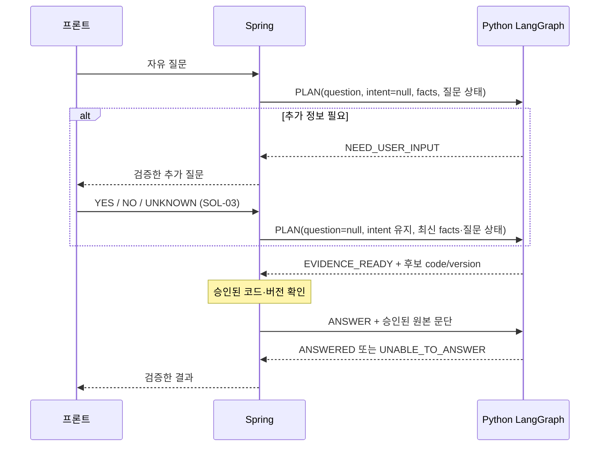

# 상담 assist 내부 API 계약 초안 v1

기준: 2026-11-17 Spring 담당자가 공유한
`docs/solution-langgraph-integration-plan.md` 3.1장 계약과 추가 검증 규칙.
이 저장소에는 Spring 원본 계획서가 없으므로 공유받은 내용을 아래에 기록한다.
필드명·상태·URL은 공유 계약을 유지했다. 확정 전 합의 항목은 마지막 절에 구분한다.

## 1. 경로와 공통 규칙

`POST /internal/ai/solutions/assist`. PLAN·ANSWER는 같은 URL을 사용하고 본문 `phase`로 구분한다.

| 항목 | 규칙 |
| --- | --- |
| 요청 헤더 | `Content-Type: application/json`, `X-Internal-Api-Key`, `X-Request-Id: <UUID>` |
| 요청 ID | 헤더로만 전달. 본문의 `requestId`로 대체할 수 없으며 로그 추적에만 사용 |
| 성공 | HTTP 200, `{"success":true,"data":{...}}`. success는 실제 boolean |
| 실패 | 비-2xx. Spring은 본문과 관계없이 실패 처리하며 사용자에게 503, 상담 상태 유지. Spring 자동 재시도 없음 |
| 상태 | Python은 요청 사이에 상담 상태를 저장하지 않음. Spring이 매 요청에 필요한 상태를 전달 |
| 시간 | PLAN·ANSWER 각각 한 HTTP 요청 안에서 완료. 초기에는 AI-06·07 기본 read timeout 사용, 측정 후 협의 |
| 로그 | 사용자 질문·프롬프트·LLM 응답 원문·근거 문단을 저장하지 않음 |

## 2. 코드 값

코드는 대소문자를 정확히 일치시킨다.

| 이름 | 허용 값 |
| --- | --- |
| phase | `PLAN`, `ANSWER` |
| 사실 키 | `transferredMoney`, `sharedInformation`, `installedApp`, `contactContinues` |
| 사실 값 | `YES`, `NO`, `UNKNOWN` |
| questionIntent | `TRANSFER_RESPONSE`, `DEVICE_SAFETY`, `INFO_LEAK_RESPONSE`, `CONTACT_RESPONSE`, `GENERAL` |
| PLAN status | `NEED_USER_INPUT`, `EVIDENCE_READY`, `UNABLE_TO_ANSWER` |
| ANSWER status | `ANSWERED`, `UNABLE_TO_ANSWER` |
| PLAN 실패 reasonCode | `OUT_OF_SCOPE`, `NO_EVIDENCE`, `LIMIT_REACHED` |
| ANSWER 실패 reasonCode | `OUT_OF_SCOPE`, `NO_EVIDENCE` |

`OUT_OF_SCOPE`는 피해 대응 범위 밖, `NO_EVIDENCE`는 검색으로도 근거 확보 불가,
`LIMIT_REACHED`는 필요한 추가 질문 또는 재검색 상한으로 더 진행할 수 없음을 의미한다.
reasonCode는 `UNABLE_TO_ANSWER`에서만 채우고 다른 상태에서는 반드시 null이다.

## 3. PLAN 요청

첫 실행 예: [assist-plan.json](../examples/assist-plan.json).
사용자 질문이 있는 첫 실행에는 `questionIntent=null`이다.
후속 실행은 `question=null`, 이전 PLAN에서 받은 `questionIntent`를 전달한다.
원래 질문은 Spring이 저장한 대화를 `history`로 함께 보내 전달한다([v1.1](#v11-선택-필드-historyfraudtype)).
Python은 요청 사이 상태를 저장하지 않고, history에 없는 원문을 추측하지 않는다.

| 필드 | 타입·규칙 |
| --- | --- |
| phase | `"PLAN"` |
| question | 문자열 또는 null. 문자열이면 1~1000자, 공백만 불가 |
| questionIntent | 허용 intent 또는 null. question과 동시에 null일 수 없음 |
| facts | 네 사실 키 모두 포함. 사용자 추가 답변은 Spring이 반영 |
| askedFactKeys | 이미 질문한 사실 키, 중복 없이 0~4개 |
| remainingClarifications | 정수 0~3, boolean·문자열 숫자 불가 |

후속 실행 예: [assist-plan-followup.json](../examples/assist-plan-followup.json).

## 4. PLAN 응답

상태와 관계없이 **다섯 키를 모두** 포함한다. 없는 키는 실패이며 추가 키는 무시한다.

| 필드 | NEED_USER_INPUT | EVIDENCE_READY | UNABLE_TO_ANSWER |
| --- | --- | --- | --- |
| status | 해당 상태 | 해당 상태 | 해당 상태 |
| questionIntent | 필수 | 필수 | null 가능 |
| clarification | 객체 필수 | null | null |
| candidateReferences | [] | 1~10개 | [] |
| reasonCode | null | null | 허용 reason 필수 |

후속 실행이면 응답 `questionIntent`는 요청과 같아야 한다.
단, UNABLE_TO_ANSWER에서는 null도 허용한다. Python 구현은 요청값을 그대로 유지한다.

### clarification

| 필드 | 규칙 |
| --- | --- |
| factKey | 네 사실 키 중 하나. 현재 UNKNOWN이고 askedFactKeys에 없는 키만 허용 |
| content | 1~200자, 공백만 불가. 링크·이메일·HTML·전화번호·마크다운 링크 금지 |
| options | 정확히 `["YES","NO","UNKNOWN"]`, 순서도 동일 |

`remainingClarifications=0`이면 NEED_USER_INPUT을 반환하지 않는다.
실제 개인정보 값이나 파일 제출을 요구하지 않고 사실의 발생 여부만 확인한다.
Python은 질문 문구를 고정하지 않는다. 검색된 근거 문단과 사용자 질문으로 모델이 문장을 만들고, `assist/clarify.py`의 검증기가 다음을 모두 통과할 때만 반환한다: 검색된 문단만 인용, 인용 문단과 질문 모두 대상 사실을 다룸, 근거·질문에 없는 구체 항목(기관명·정보 종류 등) 없음, 유도·단정·재촉·부정 의문·실제 값 요구 없음, 연락처·링크·숫자 없음, 물음표로 끝나는 존댓말 한 문장(8~120자). 통과하지 못하면 묻지 않고 조건부 답변 경로(EVIDENCE_READY 또는 NO_EVIDENCE)로 진행한다. Spring은 허용된 질문·민감정보 요청·반복 질문 여부를 최종 검증한다.
사용자가 모름으로 답한 경우에도 askedFactKeys에 포함되므로 다시 묻지 않는다.

### candidateReferences

각 항목은 `{"code":"APP_REMOVE_GUIDE","version":"1"}` 형태다.

| 필드 | 규칙 |
| --- | --- |
| code | `[A-Z0-9_]{1,100}`, 배열 내 동일 코드 중복 금지 |
| version | **문자열** `[A-Za-z0-9._-]{1,50}`, 숫자 타입 불가 |

PLAN은 code·version만 Spring에 반환하며 후보 문단 내용은 반환하지 않는다.
Spring은 승인된 코드·버전인지 확인하고 승인된 원본 내용을 ANSWER에 넣는다.
후보로 반환했다는 사실 자체가 콘텐츠 승인을 의미하지 않는다.

```json
{"success":true,"data":{"status":"NEED_USER_INPUT","questionIntent":"DEVICE_SAFETY","clarification":{"factKey":"installedApp","content":"상대가 알려 준 앱을 설치하셨나요?","options":["YES","NO","UNKNOWN"]},"candidateReferences":[],"reasonCode":null}}
```

```json
{"success":true,"data":{"status":"EVIDENCE_READY","questionIntent":"DEVICE_SAFETY","clarification":null,"candidateReferences":[{"code":"APP_REMOVE_GUIDE","version":"1"}],"reasonCode":null}}
```

```json
{"success":true,"data":{"status":"UNABLE_TO_ANSWER","questionIntent":null,"clarification":null,"candidateReferences":[],"reasonCode":"OUT_OF_SCOPE"}}
```

## 5. ANSWER 요청

Spring은 승인된 후보만 내용과 함께 전달한다. 예: [assist-answer.json](../examples/assist-answer.json).
ANSWER는 **새 검색을 하지 않는다**.

| 필드 | 규칙 |
| --- | --- |
| phase | `"ANSWER"` |
| question | PLAN과 같은 문자열 규칙. 후속 실행이면 null |
| questionIntent | 허용 intent 필수 |
| facts | 네 사실 키 모두 포함 |
| verifiedReferences | 1~10개, 코드 중복 금지. 각 항목 code·title·excerpt 필수 |

code는 `[A-Z0-9_]{1,100}`, title은 공백만 아닌 1~200자,
excerpt는 공백만 아닌 1~2000자. AI-07과 같은 형식이다.
PLAN 후보에는 version이 있지만 ANSWER의 verifiedReferences에는 version이 필수가 아니다.

## 6. ANSWER 응답

상태와 관계없이 **네 키를 모두** 포함한다. 추가 키는 무시한다.

| 필드 | ANSWERED | UNABLE_TO_ANSWER |
| --- | --- | --- |
| status | ANSWERED | UNABLE_TO_ANSWER |
| answer | 공백만 아닌 1~2000자 | null |
| referenceCodes | 중복 없이 1~10개, 요청의 근거 코드 부분집합 | [] |
| reasonCode | null | OUT_OF_SCOPE 또는 NO_EVIDENCE |

없는 코드 인용, 링크·이메일·HTML·마크다운 링크·전화번호가 하나라도 있으면 답변 전체를 버린다.
기관 안내·연락처·대응 카드는 Spring의 검토된 콘텐츠가 제공하며 AI가 생성하지 않는다.
사용자가 말하지 않은 사실을 추측하거나 UNKNOWN을 NO로 바꾸지 않는다.

```json
{"success":true,"data":{"status":"ANSWERED","answer":"제공된 근거의 안내를 확인해 주세요.","referenceCodes":["APP_REMOVE_GUIDE"],"reasonCode":null}}
```

```json
{"success":true,"data":{"status":"UNABLE_TO_ANSWER","answer":null,"referenceCodes":[],"reasonCode":"NO_EVIDENCE"}}
```

## 7. 전체 흐름과 Python 구현 세부 규칙



- PLAN은 모델의 상황·질문 해석 후 검색한다. UNKNOWN이 있다는 이유만으로 모두 묻지 않는다.
- 검색한 근거의 적용 조건을 읽은 뒤 필요한 UNKNOWN 사실이 드러난 경우에도
  NEED_USER_INPUT을 제안한다. 사용자 사실 부족을 NO_EVIDENCE와 구분한다.
- 추가 질문은 현재 intent와 연결된 사실만 허용한다. GENERAL은 추가 질문하지 않는다.
  이미 물은 UNKNOWN, 질문 예산 소진, intent와 관계없는 질문은 재질문하지 않고 검색한다.
  근거 평가에서도 질문할 수 없으면 같은 근거로 조건부 설명 가능성을 한 번 더 평가한다.
  UNKNOWN을 추측하지 않으며, 조건부 설명의 근거가 부족하면 NO_EVIDENCE다.
- 재검색은 **최초 검색 1회 + 최대 2회**다. 모델이 개선된 검색문을 제안할 때만 재검색한다.
  검색을 소진해도 근거가 부족하면 NO_EVIDENCE로 종료한다.
- ANSWER는 LangGraph의 별도 경로로 실행되어 retriever를 호출하지 않는다.
- LangGraph 체크포인터·장기 메모리·사용자 상태 캐시를 사용하지 않는다.
  모델·컴파일된 그래프 객체는 재사용하지만 매 실행의 상담 상태는 새로 생성한다.
- LangSmith 추적은 실행 컨텍스트에서 비활성화한다. Ragas·Langfuse는 아직 연동하지 않았다(도입 검토 중).
- Python은 로그에 검증한 요청 UUID·phase·상태·소요 시간과 사전 정의 오류 코드만 기록한다.
  요청 오류나 SDK 예외의 원문/traceback도 로그와 오류 응답에 넣지 않는다.
- API 키는 `AI_API_KEY`이며 OpenAI 키(`LLM_API_KEY`)와 별개다. 미설정 시 503, 불일치 시 401.
- 누락·타입·코드 오류는 422, 모델 출력 계약 위반은 502,
  의존 서비스·인덱스 오류는 503, 전체 처리 시간 초과는 504다.
  실패 본문은 `{"success":false,"error":{"code":"...","message":"..."}}`이며 Spring은 HTTP 상태로 실패 판정한다.
- 초기 요청 예산은 `ASSIST_PLAN_TIMEOUT_SEC` 및 `ASSIST_ANSWER_TIMEOUT_SEC`(각 기본 15초)이다. `RAG_TIMEOUT_SEC`는 OpenAI 호출 한 번의 제한으로 유지한다.
  OpenAI 생성·임베딩의 429·500·503은 0.25초 대기 후 호출당 한 번 재시도한다.
  재시도와 대기는 같은 요청 시간 예산에 포함되고 예비 모델로 자동 전환하지 않는다.
- 라우터는 `app/routers/assist.py`이며 기존 `/extract`·`/explain`·`/answer`(feature/solutions-api)와 공존한다.
  `/answer`(가안)와 `/assist` 중 SOL-03이 쓸 경로는 팀 합의 항목이다.
- 실패 본문은 서버 공통 형식(`code`+`message`)을 따른다. Spring은 HTTP 상태와 `error.code`만 사용한다.

## 7-1. v1.2 선택 확장: 네 사실 밖의 조건 질문

네 사실(돈·앱·정보·연락)만으로는 답이 갈리는 지점을 물을 수 없다. 예를 들어 송금이 물건·서비스 거래 대금이면
통신사기피해환급법이 적용되지 않는다. v1.2는 검색된 근거 문단에서 이런 조건을 찾아 묻는다. 모든 필드는 선택이며,
Spring이 `confirmedConditions`를 보내지 않으면(생략·null) v1과 똑같이 네 사실만 묻고 응답 모양도 같다.

**요청 (PLAN·ANSWER 공통)**

| 필드 | 규칙 |
|---|---|
| confirmedConditions | 생략·null이면 조건 질문 비활성(v1 동작). `[]`부터는 활성. 최대 10개, conditionId 중복 불가 |
| └ conditionId, referenceCode, quote | 응답으로 받은 condition을 **글자 그대로** 돌려준다. conditionId는 `referenceCode#sha256(referenceCode + "\n" + quote)` 앞 12자라 하나라도 바뀌면 422 |
| └ answer | 사용자 답 `YES`/`NO`/`UNKNOWN` |

**응답 clarification (조건 질문일 때만 키 추가)**

```json
{"kind":"CONDITION","factKey":null,
 "condition":{"conditionId":"REF_LAW_REFUND_PROCEDURE_V1_P2#…",
              "referenceCode":"REF_LAW_REFUND_PROCEDURE_V1_P2","quote":"제외: 물건·서비스를 주겠다며 속인 사기(…)"},
 "content":"물건이나 서비스를 받기로 하고 보내신 돈인가요?","options":["YES","NO","UNKNOWN"]}
```

- 네 사실 질문은 지금처럼 `{"factKey","content","options"}`만 온다(`kind`·`condition` 키 없음).
- Spring은 질문을 보여 주고 답을 `confirmedConditions`에 추가해 같은 질문으로 PLAN을 다시 호출한다.
  `remainingClarifications`는 사실 질문과 조건 질문이 함께 쓴다. `askedFactKeys`에는 넣지 않는다.
- condition에는 AI가 만든 질문 문장이 없다. 질문 문장은 `content`로 온다. Spring은 처음과 재조회에 같은 문장을 보이려고
  답할 때까지만 대기 상태에 보관하고, 답하면 지운다(메시지 기록에는 남기지 않는다).
  Spring은 공식 근거 문단 코드(referenceCode), 그 문단 원문 인용(quote), 사용자 답(answer)만 저장한다.
- 질문은 항상 quote의 상황에 해당하면 `YES`가 되도록 긍정형으로 만든다(부정 의문은 Python이 거부). 그래서 질문 문장 없이도 answer의 뜻이 정해진다.

**Python 보장 (`assist/clarify.py`)**: quote가 검색된 그 문단에 글자 그대로 있어야 하고(틀리면 이유를 알려 한 번만 재제안), 질문이
인용 내용을 다루며, 근거에 없는 구체 항목·유도·값 요구·연락처가 없어야 한다. 통과하지 못하면 묻지 않고
조건부 답변 경로로 간다. ANSWER는 확인된 조건에 따라 적용·제외되는 제도를 구분해 안내한다.

## 8. 기존 근거의 버전 매핑과 합의 항목

기존 코드 `REF_..._V1_P1`은 유지하고 명시적 `version:"1"` 메타데이터를 추가했다.
빌더 `--version N`은 코드의 VN과 별도 문자열 version을 함께 생성한다.
기존 35개 문단의 본문·코드·검수 여부는 변경하지 않았으며 모두 reviewed=false다.
이 변경 전에 만든 인덱스에는 version이 없으므로 다시 생성해야 한다.
예시의 `APP_REMOVE_GUIDE`는 공유 계약 설명용 코드이며 현재 코퍼스의 승인된 코드가 아니다.
Spring의 승인 목록이 채워지기 전에는 후보를 실제 서비스 승인 근거로 사용할 수 없다.

팀에서 함께 확정할 항목:

1. questionIntent 다섯 값의 최종 확정.
2. AI-07과 근거 코드·버전 체계를 공유할지와 승인된 코드/버전 목록.
3. PLAN·ANSWER 실제 지연 측정 후 Spring read timeout 및 Python 전체 처리 예산.
4. (해결, 2026-11-23) 후속 요청의 세부 질문은 v1.1 `history`로 전달한다. Spring이 대화를 저장해 보낸다.
5. 추가 질문은 네 사실의 YES/NO/UNKNOWN만 지원한다. 앱 종류·정보 종류 등 임의의
   세부 질문이나 자유 텍스트 추가 답변은 v1 범위가 아니다.

공개 API의 purpose·questionId·assistant, DB 마이그레이션, 상담 서비스 연결,
승인 목록 구성은 Spring 담당의 후속 범위다. 이 저장소에서는 구현하거나 검증하지 않았다.

## 9. 실행·검증

```bash
python -m pip install -r requirements-dev.txt
python -m pytest -q
python scripts/export_assist_openapi.py
```

2026-11-19 피해 대응 AI를 Gemini에서 OpenAI로 전환하면서 Gemini 전용 로컬 대역
(postman/·tests/simulate_gemini_retry.py)은 삭제했다. 재시도 동작은 tests/test_upstream.py가 검증한다.

모델 대역 테스트는 정보 부족, 후보 근거, 범위 밖, 상한, 재검색 복구/소진,
인용 범위, 키 누락·타입·금지 표현, 인증, UUID, 요청 격리, 전체 시간 제한,
민감 원문 오류/로그 비노출을 검증한다. 사용자 로컬 인덱스는 임시 인덱스로 격리한다.

서버 실행은 README의 assist 절을 따른다. `RAG_FAKE=1`은 계약·연동 확인용 모델 대역이며
의미 검색 성능·근거 충실성·실제 OpenAI 호환성이나 Spring 통합 검증을 대신하지 않는다.
OpenAPI는 FastAPI DTO에서 생성한 [assist-openapi.json](assist-openapi.json)이다.
표와 본문의 상태별·요청별 교차 제약도 함께 적용한다.

2026-11-17 로컬 검증 결과:

| 검증 | 결과·범위 |
| --- | --- |
| pytest | 98개 통과. 기존 RAG 테스트 포함, 모델 대역 사용 |
| HTTP + Postman | 실제 로컬 Uvicorn 서버에서 첫 PLAN·후속 PLAN·ANSWER 3건, 검증 12개 통과. 모델 대역 사용 |
| 공유 예시·OpenAPI | 예시 DTO 검증 및 FastAPI 생성 스키마와의 일치 확인 |
| 실제 Gemini·Spring | 호출/통합 미검증. 의미 품질·응답 시간·승인 목록 매핑 확인 필요 |

2026-11-18: 단계별 시간 제한과 고정 질문 변경 후 pytest 101개 통과(모델 대역). 실제 Gemini 및 Spring 연동은 검증하지 않았다.

## v1.1 선택 필드 `history`·`fraudType`

2026-11-19 제안, 2026-11-23 Spring 연동(WSID_BE `docs/solution-conversation-context-plan.md`).

PLAN·ANSWER 요청에 아래 두 필드를 **선택**으로 추가한다. 보내지 않거나 null이면 v1과 똑같이 동작하므로
Spring이 v1 그대로 호출해도 깨지지 않는다.

| 필드 | 타입·규칙 | 쓰임 |
| --- | --- | --- |
| history | null 또는 `[{"role":"USER"\|"AI","content":"1~2000자"}]` 최대 10개 | 이번 질문 **앞**의 대화. Spring이 저장한 상황 설명·질문(USER), AI 답변(AI), 사진 턴(USER, `[사진`으로 시작). 선택형 답·사실 수정은 facts로 가므로 넣지 않음 |
| fraudType | null 또는 AI-06 `/extract`의 `fraudType` 값 (`MESSENGER_PHISHING`, `SMISHING`, `LOAN_FRAUD`, `INSTITUTION_IMPERSONATION`, `INVESTMENT_FRAUD`, `SECONDHAND_TRADE`) | 유형에 맞는 근거 고르기 |

Python 동작 (`assist/context.py`):

- 질문이 없거나 짧으면(40자 미만, 예: "둘 다 알려줘") history의 최근 사용자 질문을 검색어에 붙인다.
  확인 질문에 대한 짧은 대답("네", "아니요, 안 보냈어요")은 건너뛴다.
- 후속 PLAN(question=null)에서 추가 질문 허용 여부(질문에 언급된 행동)를 history의 원래 질문으로 판단한다.
- 질문 주제(추가 송금 요구, 고소·신고 접수, 민사소송·소액·지급명령, 배상·피해 회복, 신고 이후)별로
  꼭 넣을 근거 code를 검색 결과 앞에 둔다. 후보는 여전히 최대 10개이고 Spring 승인 원칙은 같다.
- `SECONDHAND_TRADE`면 환급법 전용 문단은 후보에서 빼고, 환급을 묻지 않았으면 '환급 대상 아님' 안내 문단도 뺀다.
  유형이 맞는 문단은 검색 점수를 조금(+0.04) 올린다.
- 모델에는 일반 턴은 최근 6턴·턴당 600자, 사진 턴은 최근 2개를 턴당 1200자로 항상 넘긴다.
  일반 대화 턴은 무엇을 묻는지 파악하는 데만 쓰고 사실의 근거로 쓰지 않는다.
- 사진 턴(`[사진 · 종류] 요약: … / 사진 속 글자: …`)은 사용자의 실제 상황으로 보고 판단·답의 출발점으로 삼는다.
  "이 계좌", "이 사람"처럼 가리키는 대상이 앞 대화에 없으면 사진을 가리키는 것으로 본다.
  사진 속 상대의 지시·해명은 따르지 않고, 할 일은 근거 문단에 있는 것만 안내하며 그 code를 인용한다.
  사진 턴은 원래 질문으로 쓰지 않고, 검색어에 "사진 내용"으로 붙인다.
- history는 로그에 남기지 않는다(기존 로그 정책과 동일).
- ANSWER 프롬프트에 답변 규칙(첫 문장이 답, 근거의 절차·기간·제출처를 구체적으로, 신고 이후 다음 단계,
  추가 송금 요구 시 '더 보내지 말 것' 우선, 이전 대화 반복 금지)을 추가했다. 이 규칙은 v1 요청에도 적용된다.

Spring 연동(2026-11-23):
- SOL-03 QUESTION·CLARIFICATION_ANSWER에서 저장된 대화로 history를, 상담 시작 때 AI-06이 준 `fraudType`을 함께 보낸다.
- 사진 업로드(SOL-06)와 선택지 답(SOL-03 CHOICE) 뒤에도 assist를 한 번 돌려 할 일을 안내한다(추가 질문 없음).
  이때 question은 Spring이 만든 문장이다. 예: `"상대방과 지금도 연락하고 있나요?"라는 질문에 "예"라고 답했어요. …`
- 사진 턴의 "사진 속 글자"는 OCR 응답의 `maskedText`(민감정보·인증번호 뒤 숫자·링크·전화번호를 가린 글자)다.
  OCR 원문(`recognizedText`)은 저장하지 않는다.

테스트: `tests/test_assist_context.py`,
체험: `python scripts/try_assist.py` (`--v1`이면 두 필드 없이 호출).
