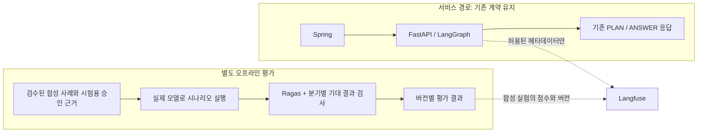

**WSID 상담 assist: Ragas·Langfuse 도입 영향 검토 리포트**

작성일: 2026-11-18 · 대상: Python AI 담당, Spring 백엔드 담당, 프로젝트 의사결정자

이 문서는 작성 시점의 도입 검토 기록이다. 이후 추가 질문 처리, 오류 로그·재시도,
타임아웃 설정에 변경이 있으므로 현재 동작은 [내부 계약](assist-internal-contract-v1.md)과 코드를 확인한다.

검토 기준은 현재 저장소의 FastAPI·LangGraph 구현과 공유된 상담 assist 내부 계약 v1이다.
외부 기능은 작성일에 확인한 공식 문서에 근거한다. 아래 도입 효과·설계·실험 규모는 제안이며,
실제 도입이나 품질 측정 결과가 아니다. 이번 작업은 리포트 작성이며 패키지 설치·서비스 연동은 하지 않았다.

**1. 권고안**

현재는 **검수된 근거와 평가 시나리오를 준비해 Ragas 오프라인 평가를 먼저 도입하고,
Spring 연동 단계에 Langfuse를 원문 없는 메타데이터 추적으로 추가하는 방안**을 권고한다.

두 도구의 직접 효과는 품질과 실행 과정을 측정하는 것이다. 측정 결과를 보고 사람이
프롬프트·검색·근거·분기를 수정해야 실제 답변이 개선된다. 도구를 추가하는 것만으로
상담 가능한 상황이나 추가 질문 항목이 늘어나지는 않는다.

| 선택 | 도입하면 얻는 것 | 남는 한계 | 현재 적합성 |
| --- | --- | --- | --- |
| 기존 테스트만 유지 | DTO·인증·상한·인용 형식 등의 회귀 검사 | 실제 답변의 의미적 정확성과 검색 품질을 충분히 측정하지 못함 | 기본 안전장치로 계속 필요 |
| Ragas 먼저 | 고정 시나리오에서 검색·생성 변경 전후를 비교 | 운영 중 지연·장애 위치를 자동으로 설명하지 않음 | 우선 권고 |
| Langfuse 먼저 | 단계별 시간·호출량·실패 위치·사용량 파악 | 메타데이터만으로 실제 답변 내용을 재검토하기 어려움 | 서버 통합 디버깅이 급하면 먼저 가능 |
| 둘 다 단계적으로 | 오프라인 품질 평가와 운영 분석을 연결 | 평가셋·수집 정책·유지관리 작업이 함께 생김 | 중기 권고 |

Langfuse에도 평가·데이터셋·실험 기능이 있으므로 두 제품이 반드시 필요한 것은 아니다.
Ragas를 채택한다면 지표 정의와 평가 코드는 한 곳에서 관리하고, Langfuse는 필요한
추적·결과 조회에 사용하는 방식으로 중복 평가 체계를 줄이는 것이 좋다.
[Langfuse 평가 개요](https://langfuse.com/docs/evaluation/overview)

**2. 현재 구현에서 확인한 사실**

| 항목 | 현재 상태 | 도입 검토에 주는 의미 |
| --- | --- | --- |
| 내부 API | PLAN·ANSWER 공용 `POST /internal/ai/solutions/assist` | 두 단계와 각각의 HTTP 요청을 구분해 측정해야 함 |
| PLAN 그래프 | assess → search → evaluate, 필요 시 재검색 | 최초 분류·검색·근거 평가를 따로 관측할 수 있음 |
| 추가 질문 | 네 사실 키의 YES·NO·UNKNOWN만 지원 | 임의의 세부 질문은 도구 도입으로 해결되지 않음 |
| 재검색 | 최초 1회 + 최대 2회 | 재검색의 비용과 실제 효과를 비교할 수 있음 |
| ANSWER | Spring이 보낸 verifiedReferences만 사용, 새 검색 없음 | 답변 충실성은 실제 ANSWER 입력 문단으로 평가해야 함 |
| 후속 요청 | question=null, intent와 최신 facts·질문 상태 전달 | 원문 질문 관련성 평가는 운영 데이터만으로 복원 불가 |
| 시간 제한 | PLAN·ANSWER 각각 전체 요청 예산, 기본 30초 | 평가용 추가 LLM 호출을 사용자 응답 경로에 넣기 어려움 |
| 로그 | UUID·phase·상태·소요 시간. 원문 질문·프롬프트·응답·근거 저장 금지 | 기본 자동 추적을 그대로 적용하면 계약과 충돌할 수 있음 |
| 추적 | LangSmith 추적 비활성화, Ragas·Langfuse 미연동 | 별도 도입 작업 필요 |
| 근거 | 문단 35개, reviewed=true 0개, 문자열 version 포함 | 평가 기준과 승인 목록을 만들기 전에 내용 검수가 선행돼야 함 |
| 검증 이력 | 11월 17일 문서에 모델 대역 테스트 98개·HTTP 검증 12개 통과 기록 | 실제 Gemini 품질이나 실제 Spring 통합 완료의 증거는 아님 |

근거: [내부 계약](assist-internal-contract-v1.md), [API](../app.py),
[LangGraph](../assist/graph.py), [모델 어댑터](../assist/model.py),
[검색](../assist/retrieval.py), [문단 데이터](../data/references/references.jsonl).
문단 수·검수 상태는 이번 검토에서 다시 확인했다. 기존 테스트는 이번 문서 작성 중 재실행하지 않았다.

현재 `evaluate` 노드는 서비스가 실행 중 근거를 선택하는 AI 판단 단계다.
Ragas 평가가 이미 붙어 있다는 뜻은 아니다. 서비스의 판단 자체가 적절했는지 별도 평가가 필요하다.

**3. Ragas를 도입하면 바뀌는 일**

지금은 테스트 통과 여부로 계약과 실행 흐름을 확인한다. Ragas를 별도 평가 작업으로 추가하면
동일한 사례에서 어떤 근거를 검색했고, 생성한 답변이 그 근거를 따랐는지 비교할 수 있다.

예를 들어 검색 가중치나 프롬프트를 변경할 때 다음 순서로 작업한다.

1. 사람이 검수한 합성 시나리오와 기대 결과를 고정한다.
2. 기존 버전과 변경 버전을 같은 데이터·승인 근거 조건에서 실행한다.
3. PLAN 판단은 기대 상태·추가 질문·후보 코드와 비교한다.
4. ANSWERED 답변에는 선택한 Ragas 지표를 적용한다.
5. 점수가 나빠진 사례와 위험한 오류를 사람이 읽고 변경 채택 여부를 결정한다.

서비스 응답에 Ragas 점수를 추가할 필요는 없다. 평가 스크립트를 API 경로 밖에 두면
현재 Spring 요청·응답 계약을 유지하면서 실험을 시작할 수 있다.

| 평가 대상 | 권고 지표·방법 | 필요한 기준 데이터 | 주의점 |
| --- | --- | --- | --- |
| 원 검색 결과의 순위 | Context Precision | 선택한 변형에 맞는 질문·정답 설명 또는 관련 문단 판정 | 모델이 골라낸 후보만 평가하면 검색 단계의 문제를 놓침 |
| 중요한 근거 누락 | ID 기반 precision/recall 또는 Context Recall | 검수한 기대 코드·버전 집합 또는 정답 설명 | 정답 근거가 없으면 누락 여부를 신뢰성 있게 계산하기 어려움 |
| ANSWER의 근거 충실성 | Faithfulness | 실제 ANSWER에 전달된 근거 문단과 생성 답변 | 근거가 최신·정확한지까지 인증하는 지표는 아님 |
| 첫 질문에 대한 관련성 | Response/Answer Relevancy | 원 질문과 생성 답변 | 사실 정확성을 대신하지 않으며 후속 question=null에는 직접 적용하지 않음 |
| PLAN의 추가 질문·종료 판단 | 프로젝트 전용 기대 결과 및 사람 검수 | 허용 상태, 필요한 사실, 물으면 안 되는 항목 | 일반 RAG 점수만으로 분기 정확성을 판단하지 않음 |

Context Precision은 관련 문단의 순위 적절성을 보며, ID 기반 지표는 기대 문단 식별자와의
일치를 계산할 수 있다. 이 프로젝트에서는 코드와 version의 조합을 평가용 식별자로 사용하는
방안을 권고한다. [Ragas Context Precision](https://docs.ragas.io/en/stable/concepts/metrics/available_metrics/context_precision/)

Context Recall은 비교할 기준을 필요로 한다. 기대 문단 집합이나 정답 설명을 사람이 준비해야 한다.
[Ragas Context Recall](https://docs.ragas.io/en/stable/concepts/metrics/available_metrics/context_recall/)

Faithfulness는 답변의 주장이 제공 문맥에서 뒷받침되는지를 평가한다. 낮은 점수는 근거 밖의
설명을 의심할 단서지만, 높은 점수만으로 해당 안내의 현실 적용이나 자료의 최신성이 검증되지는 않는다.
[Ragas Faithfulness](https://docs.ragas.io/en/stable/concepts/metrics/available_metrics/faithfulness/)

Answer Relevancy는 질문과 답변의 관련성을 평가하며 사실 정확성은 별개다.
후속 요청의 intent를 원 질문처럼 넣어 계산한 점수는 다른 평가 과제이므로,
원문 질문에 대한 점수와 합쳐 보고하지 않는다.
[Ragas Response Relevancy](https://docs.ragas.io/en/stable/concepts/metrics/available_metrics/answer_relevance/)

평가에서는 다음 세 단계를 구분해 기록해야 한다.

| 근거 단계 | 평가하려는 문제 |
| --- | --- |
| retriever가 찾은 문단 | 검색이 필요한 내용을 놓치거나 관련 없는 문단을 앞에 놓았는가 |
| PLAN이 고른 후보 | AI가 검색 결과 중 적절한 근거를 선택했는가 |
| Spring이 승인해 ANSWER에 보낸 문단 | 실제 답변에 허용된 근거가 무엇이며 답변이 이를 따랐는가 |

현재 API 응답만 수집하면 첫 단계의 원 검색 결과는 보이지 않는다. 오프라인 평가 실행기에
테스트 전용 관측 지점을 두거나 주입 가능한 retriever를 사용해야 한다. 운영 로그에 문단을
추가하는 방식으로 해결하지 않는다. Spring 승인 절차를 시험용 승인 목록으로 대신한 실험은
실제 Spring 통합 결과와 구분한다.

**4. 평가셋과 점수 해석의 제안**

첫 평가셋은 실제 고객 원문을 모으는 대신, 사람이 작성하고 검수한 **합성 시나리오 60개**로
시작하는 안을 제안한다. 이는 충분한 통계적 표본이라는 주장이 아니라 작은 초기 실험 범위다.

| 사례군 | 제안 수 | 확인할 내용 |
| --- | --- | --- |
| intent 다섯 종류 | 40개, 각 8개 | 질문 표현·사실 조합·조건부 답변·필요한 추가 질문 |
| 범위 밖·지시문 주입 | 8개 | OUT_OF_SCOPE와 자료 속 지시 무시 |
| 적합한 근거 없음 | 6개 | 억지 답변 대신 NO_EVIDENCE |
| 질문 상한·이미 물은 UNKNOWN | 6개 | 반복 질문 방지, 필요한 경우 LIMIT_REACHED |

40개 intent 사례 중 일부는 첫 요청과 후속 요청을 포함하는 다단계 시나리오로 만든다.
따라서 HTTP 요청 수와 생성 답변 수는 60과 다를 수 있다.

각 사례에는 입력뿐 아니라 허용되는 PLAN 상태, 필요한 추가 질문 항목, 질문 금지 항목,
기대 근거 코드·버전, 답변의 필수 내용과 금지 주장을 기록한다. 정답 문장 하나와의 완전 일치보다
상황에 맞는 판단과 근거 사용을 검토한다.

후속 요청 테스트에서도 실제 계약처럼 question=null을 보낸다. 평가 실행기가 합성 원 질문을
보관해 최종 목표 충족을 평가할 수는 있지만, 그 원문을 모델에 몰래 다시 넣으면 현재 계약을
시험한 결과가 아니다. 같은 intent라도 세부 질문이 다른 사례를 넣어 정보 손실의 영향을 확인한다.

LLM 평가에는 판정 편차가 있으므로 생성 모델·평가 모델·프롬프트 버전·데이터셋 버전·근거 버전을
고정해 비교한다. 일부 사례는 사람이 교차 검토하고 반복 측정한다. 필요하면 다른 평가 모델과
비교하되, 다른 모델을 쓴다는 이유만으로 판정이 정답이라고 가정하지 않는다.

NEED_USER_INPUT이나 적절한 답변 보류에 Faithfulness를 일괄 0점 처리하지 않는다.
ANSWERED 사례의 의미 점수, 답변 가능한 사례에서의 답변 제공 비율, 잘못된 답변 보류 비율을
함께 보고한다. 답변이 하나도 없으면 의미 점수는 산출 불가로 표시한다.
높은 점수를 얻기 위해 어려운 질문을 모두 거절하는 변경을 개선으로 채택하지 않기 위해서다.

**5. Langfuse를 도입하면 바뀌는 일**

현재 로그로는 한 요청의 최종 상태와 전체 시간은 볼 수 있지만, assess·검색·근거 평가 중
어디서 시간이 걸렸는지는 구분하기 어렵다. Langfuse 관측 지점을 추가하면 단계별 시간,
호출 수, 검색 시도 수, 모델 사용량을 비교하는 대시보드를 만들 수 있다.
[Langfuse 관측 개요](https://langfuse.com/docs/observability/overview)

| 새로 답할 수 있는 운영 질문 | 필요한 수집 값 | 얻는 판단 근거 |
| --- | --- | --- |
| PLAN이 왜 느린가 | assess·embedding·evaluate별 소요 시간 | 모델 판단과 검색 중 병목 구분 |
| 재검색이 도움이 되는가 | 시도 수와 최종 상태, 평가 환경의 품질 점수 | 비용 증가에 상응하는 개선 여부 |
| 어떤 실패가 발생하는가 | 단계, HTTP 결과, 사전 정의 오류 코드 | 형식 위반·시간 초과·의존 서비스 장애 구분 |
| 모델 변경 뒤 비용이 늘었는가 | 모델 식별자, 입력·출력 사용량, 가격 정의 | 호출당·배포 버전별 비용 비교 |
| 추가 질문이 과도한가 | NEED_USER_INPUT 비율과 평가셋의 정답 판정 | 질문 횟수와 실제 필요성을 함께 검토 |

단, 상태 비율은 원인을 증명하지 않는다. 예를 들어 NO_EVIDENCE 증가가 코퍼스 문제인지,
질문 분포 변화인지, 모델이 더 보수적으로 판단해서인지는 추가 실험이 필요하다.

현재 Gemini는 LangChain 모델 래퍼가 아니라 `google-genai` SDK로 직접 호출한다.
LangGraph callback을 추가하는 것만으로 내부 Gemini의 사용량까지 자동 수집된다고 가정하면 안 된다.
`GeminiAssistModel._generate()`는 현재 파싱한 JSON만 반환하므로, 사용량을 기록하려면
SDK 응답의 usage 메타데이터를 읽는 별도 계측이 필요하다. 임베딩 사용량도 따로 다뤄야 한다.
Langfuse는 사용량을 전달받고 모델 가격 정의로 비용을 추산하거나 비용을 직접 전달받을 수 있다.
표시 금액은 모델·캐시·추론 토큰 등의 계산 규칙을 맞춘 추정치이며 공급자 청구액과 대조해야 한다.
[Langfuse 토큰·비용 추적](https://langfuse.com/docs/observability/features/token-and-cost-tracking)

관측 지점을 추가해도 기존 계약 검사와 Spring의 최종 검증은 유지한다.
Langfuse 관측 서버가 응답하지 않는 경우에는 상담 처리를 계속하고 관측만 포기하도록 설계한다.
SDK의 배경 큐·배치 전송을 활용하되 요청마다 동기 전송 완료를 기다리지 않는다.
계측 자체의 CPU·직렬화·큐 비용은 별도 부하 시험으로 확인한다.
[Langfuse 배치 전송](https://langfuse.com/docs/observability/features/queuing-batching)

**6. 원문 로그 금지 규칙과의 충돌 및 해결 방향**

현재 계약은 질문·프롬프트·모델 응답·근거 문단의 원문 저장을 금지한다.
따라서 자동 추적 예제를 그대로 붙여 입력과 출력을 수집하는 방식은 현재 계약에 맞지 않는다.
LangGraph 상태에는 요청과 문단이 들어 있고, 함수 오류에도 원문이 포함될 수 있다.

Langfuse 자동 계측은 입력·출력·오류를 수집할 수 있고, 수동 관측과 입출력 캡처 해제도 지원한다.
**이 프로젝트에서는 수동으로 허용한 메타데이터만 생성하는 방식**을 먼저 검토한다.
decorator의 입출력 캡처를 꺼도 예외 메시지·다른 계측기의 속성까지 모두 안전해지는지는
별도 확인해야 한다. [Langfuse 계측 방식](https://langfuse.com/docs/observability/sdk/instrumentation)

| 구분 | 초기 수집 제안 |
| --- | --- |
| 기존 허용 값 | 검증된 요청 UUID, phase, 상태, 소요 시간 |
| 팀 합의 후 추가할 값 | 고정 노드 이름, 모델·배포 버전, 호출·검색 횟수, 사용량, 문단 개수, 사전 정의 오류 코드 |
| 초기에는 수집하지 않을 값 | 사용자·상담 세션 식별자, facts 값, 질문 의도, 근거 코드 목록 등 상담 내용을 유추할 수 있는 값 |
| 계속 제외할 원문 | 질문, 질문에서 만든 검색문, 추가 질문 문장, 프롬프트, 답변, 근거 문단, SDK 예외/traceback, 헤더 전체 |

확장 메타데이터는 현행 로그 허용 목록에 없으므로 보관 범위·접근 권한·전송 위치와 함께
정책에 반영해야 한다. 이름이나 전화번호만 가리고 질문 본문을 남기는 것도 원문 보관 문제를
해결했다고 볼 수 없다. self-hosted 배포도 이 계약의 예외가 아니다.

마스킹은 유출을 줄이는 보조 장치로 사용한다. 우선 수집 단계에서 원문을 넣지 않고,
내보내기 직전에 허용 목록 밖 속성을 제거하며, 테스트용 표식이 전송되지 않는지 확인한다.
현재 공식 Python 문서는 새 구성에 export 단계의 `mask_otel_spans`를 권고하고,
legacy `mask`는 타사 계측기의 최종 OTel 속성을 모두 다루지 않는다고 설명한다.
구현 시 사용할 SDK 버전에 맞춰 적용 범위를 확인해야 한다.
[Langfuse 마스킹](https://langfuse.com/docs/observability/features/masking)

현재의 `tracing_context(enabled=False)`는 LangSmith 추적 제어다. 이것만으로 추후 설치할
Langfuse/OpenTelemetry의 수집까지 차단된다고 가정하지 않는다. 관측 데이터가 실제로
내보내지는 경계에서 별도 검증이 필요하다.

원문 없는 운영 trace로는 다음 작업이 제한된다.

- 실제 답변 문장을 나중에 읽고 잘못된 표현을 재검토하는 작업.
- 과거 운영 질문을 그대로 재현하거나 자동으로 Ragas 평가셋에 넣는 작업.
- 저장하지 않은 질문·답변·근거를 필요로 하는 온라인/사후 의미 평가.

초기에는 합성 평가셋과 코드·버전·운영 통계로 문제를 재현하는 방식이 현실적이다.
실제 고객 사례를 평가에 사용하려면 별도의 처리·보관 정책이 먼저 필요하다.

Ragas를 로컬 Python 라이브러리로 실행해도 평가용 LLM·임베딩이 외부 서비스라면
질문·답변·근거가 그 평가 서비스로 전달될 수 있다. 평가 결과 파일, 캐시, 판단 근거 설명,
자동 추적에도 입력 내용이 남을 수 있으므로 별도 점검한다. 초기 실험에는 합성 질문과
검수된 시험용 자료만 사용하고, 실제 고객 요청을 평가 큐에 복사하지 않는 구성을 권고한다.

**7. Spring 계약과 추적 연결에 미치는 영향**

Ragas를 별도 개발 평가로 실행하고 Langfuse에 허용된 메타데이터만 보낸다면
기존 PLAN 5키·ANSWER 4키 응답 형식에 점수나 traceId를 추가할 필요는 없다.
추적을 이유로 Python에 상담 상태를 저장할 필요도 없다.

`X-Request-Id`는 HTTP 요청별 추적 식별자다. Langfuse trace ID 형식에 맞는 결정적 변환을
적용해 같은 요청의 Spring 로그와 Python 관측을 연결할 수 있다.
UUID 문자열을 변환 없이 OTel trace ID 자리에 넣는 방식은 피한다.
[Langfuse trace ID와 외부 ID 연결](https://langfuse.com/docs/observability/features/trace-ids-and-distributed-tracing)

다만 첫 PLAN·추가 답변 후 PLAN·ANSWER가 자동으로 하나의 상담 trace가 되지는 않는다.
현재 계약에는 상담 흐름 전체를 연결하는 별도 ID/trace context가 없다.
요청별 UUID의 연결 관계는 Spring이 관리하거나, 필요할 때 원문 없는 별도 상관관계
헤더를 합의해야 한다. X-Request-Id를 상담 ID로 재사용하거나 사용자 ID를 임의 전송하지 않는다.

ANSWER 문단에는 version이 필수가 아니므로 승인된 최종 문단 버전을 Langfuse에서
추적하려면 Spring이 가진 승인 버전 정보와의 연결 방식을 별도로 정해야 한다.
기존 필드만으로 모든 버전 관계를 안다고 표시하지 않는다.

**8. 둘을 함께 사용할 때의 제안 구조**

이 그림은 도입 제안이며 현재 연동 상태가 아니다.
Ragas 점수를 Langfuse에서 함께 조회하는 구성은 가능하지만, 원문 없는 운영 trace에
점수를 붙이는 것만으로 사후 의미 평가가 가능해지는 것은 아니다.
초기 연결 대상은 합성 데이터 기반 실험 결과로 한정한다.
[Langfuse의 Ragas 평가 예시](https://langfuse.com/resources/engineering/evaluation-of-rag-with-ragas)

운영의 재검색 횟수·지연 증가와 오프라인의 근거 충실성·검색 품질을 나란히 비교하면,
예를 들어 재검색 횟수를 줄이는 변경이 속도만 개선하고 중요한 근거를 놓치는지 확인할 수 있다.
관측 수치와 평가 점수가 자동으로 원인을 확정하거나 코드 수정까지 수행하는 것은 아니다.

**9. 비용과 응답 시간에 생길 변화**

현재 코드에서 도출되는 호출 수는 다음과 같다. timeout·예외로 중단되지 않고 해당 경로를
완주했을 때의 호출 수이며, 측정값이 아니다. 공급자 내부 처리 횟수와도 구분한다.

| 실행 경로 | 생성 모델 호출 | 질의 임베딩 호출 |
| --- | --- | --- |
| PLAN에서 즉시 추가 질문 또는 범위 밖 종료 | 1 | 0 |
| PLAN 최초 검색 후 근거 준비 | 2: assess + evaluate | 1 |
| PLAN 재검색 2회까지 수행 | 최대 4: assess + evaluate 3회 | 최대 3 |
| ANSWER | 1 | 0 |

따라서 PLAN 1회와 ANSWER 1회의 일반 경로는 생성 3회·임베딩 1회이고,
재검색을 소진하는 경로는 생성 최대 5회·임베딩 최대 3회다.
추가 질문을 거친 상담에는 별도의 PLAN 요청이 더해진다.

Ragas의 LLM 기반 지표는 점수 하나를 계산하는 데도 여러 호출이 필요할 수 있다.
관련성 지표 등은 임베딩도 사용한다. 따라서 사례 수 × 지표 수만으로 평가 API 호출 수나
비용을 확정할 수 없다. [Ragas 지표 개요](https://docs.ragas.io/en/latest/concepts/metrics/available_metrics/)

평가 비용은 다음 항목을 합해 추정한다.

`평가 총비용 = 평가 대상 파이프라인 실행비 + 평가용 LLM 입력/출력비 + 평가용 임베딩비`

생성 모델·평가 모델·실제 토큰량·실험 빈도가 정해지지 않아 원화나 달러 금액을 단정하지 않는다.
먼저 일부 합성 사례를 실행해 사용량을 측정하고 전체 평가 규모로 환산한다.
평가 작업이 서비스와 같은 공급자 할당량을 사용하면 운영 요청에 영향을 줄 수 있으므로
평가 실행량과 동시성을 따로 제한한다.

Langfuse Cloud의 사용량 단위는 trace·observation·score를 합한 값이다.
한 HTTP 요청이 한 과금 단위라는 가정은 맞지 않는다.
[Langfuse 사용량 단위](https://langfuse.com/docs/administration/billable-units)

가정 예시: 한 달 HTTP 요청 N=30,000건, 요청별 trace 1개와 observation 평균 7개,
score 전송 없음이면 총 240,000단위다. 이 숫자는 현재 트래픽이나 실제 계측 개수가 아니다.
무작위 trace 샘플링 20%를 적용하면 기대 전송량은 약 48,000단위지만, 실제 값은 달라지고
미수집 trace의 오류도 놓칠 수 있다. [Langfuse 샘플링](https://langfuse.com/docs/observability/features/sampling)

실제 요금은 선택한 플랜과 당시 가격표를 적용한다.
[Langfuse 가격표](https://langfuse.com/pricing)

오프라인 Ragas는 사용자 응답 시간 경로에 넣지 않는 것이 권고안이다.
Langfuse는 배경 전송을 사용해도 오버헤드가 정확히 0이라고 가정하지 않는다.
도입 전후 p50·p95·timeout 비율·메모리를 같은 조건에서 비교한다.

자체 호스팅을 선택하면 구독 비용 대신 설치·업그레이드·접근 제어·백업 등의 운영 부담이 생긴다.
현재 공식 v4 구성에는 Web·Worker와 PostgreSQL, Redis/Valkey, ClickHouse, 객체 저장소가 포함된다.
로컬 Docker Compose 시험과 운영 고가용성 구성을 같은 수준으로 보지 않는다.
[Langfuse 자체 호스팅](https://langfuse.com/self-hosting)

**10. 코드·업무에서 추가할 작업**

아래 경로는 작업 위치 제안이며 이번 리포트에서 실제 파일을 추가하거나 서비스를 변경한 것은 아니다.

| 영역 | 추가·변경할 작업 | 주 담당 |
| --- | --- | --- |
| 평가셋 | 합성 사례, 허용 상태, 기대 근거·금지 주장, 승인 근거 fixture 작성 | Python + 콘텐츠 검수 담당 |
| 오프라인 실행기 | PLAN→시험용 승인 확인→ANSWER 및 후속 요청 실행, 버전 기록 | Python |
| 평가 스크립트 | Ragas 지표와 분기별 검사를 분리하고 사례별·intent별 결과 출력 | Python |
| 의존성 | Ragas는 평가용 의존성으로 분리, Langfuse는 도입 시 선택적 구성 | Python |
| app.py | 요청별 원문 없는 관측 시작·종료, 시간 초과·관측 장애 처리 | Python |
| assist/graph.py | assess·search·evaluate·answer 시간과 횟수 계측 | Python |
| assist/model.py | Gemini 사용량 추출, 모델 식별, 원문 없는 오류 분류 | Python |
| assist/retrieval.py | 임베딩 시간·사용량·결과 개수 계측 | Python |
| 계약·정책 | 확장 메타데이터 허용 목록, 보관 기간·전송 위치·접근 권한 | Spring + 팀 |
| 요청 연결 | UUID별 Spring 로그 연결, 필요 시 별도 흐름 상관관계 합의 | Spring + Python |
| 운영 | 관측 서비스 설정, 접근 관리, 장애·비용·데이터 수집 점검 | 운영 담당 |

현재 코드의 파싱·금지 표현·인용 범위 검증은 유지한다.
유의미한 오류 사유를 기록하려면 실제 응답 메시지나 예외 문자열 대신 사전에 정한 코드로
분류해야 한다. 원문을 포함할 수 있는 ValidationError/SDK 예외를 통째로 exporter에 넘기지 않는다.

**11. 도입 후 발견할 수 있는 상황과 대응**

| 상황 | 도구가 보여줄 단서 | 팀이 해야 할 변경 |
| --- | --- | --- |
| 근거 코드는 맞지만 설명이 문단 밖의 내용을 단정 | Ragas 충실성 저하와 사람 검수 결과 | ANSWER 프롬프트·근거 구성·생성 제약 수정 |
| 검색 문단은 있으나 필요한 내용 누락 | 검색 recall 또는 기대 코드 일치율 저하 | 코퍼스 보강·질의 생성·순위 조정 |
| 근거를 읽은 뒤에도 불필요한 질문 반복 | PLAN 기대 결과 실패, 질문 상태 통계 | 필요 정보 판단과 상태 처리 수정 |
| 평가 점수는 높지만 답변 보류가 지나치게 많음 | 답변 제공 비율·보류 오판 비율 악화 | 점수 집계와 판단 기준 재검토 |
| 재검색 후에도 결과가 비슷하고 지연만 증가 | 검색별 시간·최종 상태, 합성 실험 품질 변화 없음 | 검색문 개선 또는 재검색 기준 수정 |
| 후속 질문 답변이 원 질문의 세부 의도를 잃음 | 합성 다단계 시나리오의 목표 충족 실패 | intent 표현력·계약을 재검토. 관측 도구로 원문 복원 불가 |
| 관측 서비스 장애 때문에 상담까지 실패 | 장애 주입 시험에서 API 오류 증가 | 관측 예외 격리·큐/전송 설정 수정 |
| 메타데이터만으로 실제 오답 원인을 재현하기 어려움 | 시간·단계는 보이나 내용 확인 불가 | 합성 재현 사례와 검수 확대. 원문 수집은 별도 정책 문제 |

위 사례는 발견 가능성에 대한 분석이며 현재 서비스에서 발생했다고 확인한 사건은 아니다.
점수 향상률·비용 절감률·장애 감소율은 아직 산출하지 않았다.

**12. 단계별 실행과 완료 판단**

| 단계 | 실행 내용 | 완료 판단 |
| --- | --- | --- |
| 1. 평가 기준 확보 | 근거 검수, 승인 코드/버전 매핑, 합성 시나리오 준비 | 기대 판단·근거가 검수돼 있고 버전 고정 가능 |
| 2. Ragas 소규모 실험 | 실제 생성 모델과 별도 평가 작업으로 기준 버전 측정 | 사례별 결과와 실패 원인을 재현하고 사람 판정과 대조 가능 |
| 3. 관측 시험 | 개발 환경에서 메타데이터만 Langfuse로 전송 | 표식 원문·비밀값이 exporter에 없고 장애 시 상담 동작 유지 |
| 4. 통합 비교 | 평가 결과와 운영 지연·사용량을 버전별 비교 | 품질과 비용·시간의 변화가 함께 설명되고 기존 계약 회귀 검사 통과 |

초기에는 임의의 평균 점수 기준 하나로 배포를 막지 않는다. 평가셋과 사람 판정으로 허용 기준을
정하고, 계약 위반·금지 출력·인용 범위·반복 질문 검사는 별도의 필수 통과 항목으로 유지한다.
샘플에서 위반이 0건이라는 사실을 모든 실제 요청의 무오류 보장으로 해석하지 않는다.

이번 검토의 권고는 **합성 평가와 검수에 기반한 Ragas 도입을 먼저 진행하고,
원문 없는 Langfuse 관측은 계약·운영 범위를 정한 후 단계적으로 적용하는 것**이다.
실제 Gemini와 Spring 연동이 아직 검증되지 않았으므로, 첫 실험의 목적은 개선율을 홍보하는 것이
아니라 기준 성능·실패 사례·시간 예산을 확보하는 데 둔다.
